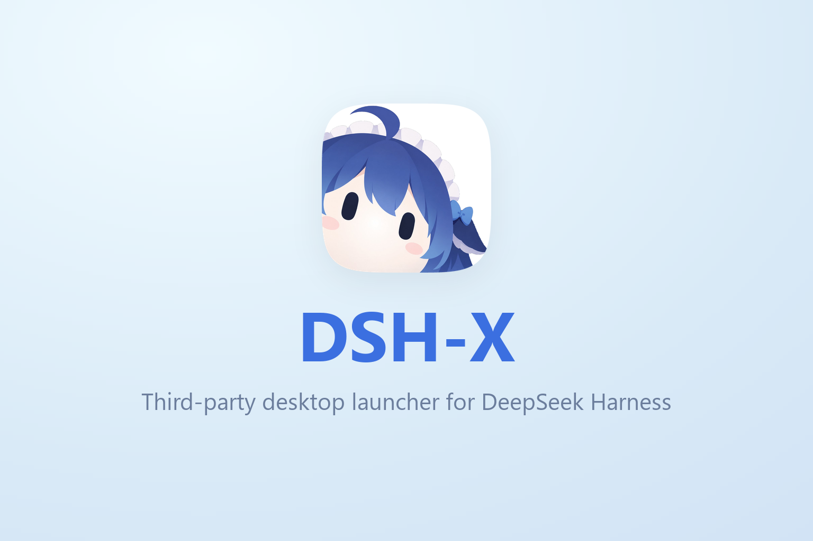

<p align="center">
  
</p>

<p align="center">
  <a href="https://yyh-001.github.io/DSH-X/">Website</a>
  ·
  <a href="https://github.com/yyh-001/DSH-X/releases/latest">Download</a>
  ·
  <a href="https://github.com/yyh-001/DSH-X">Star</a>
  ·
  <a href="README.md">中文</a>
</p>

<p align="center">
  <a href="https://github.com/yyh-001/DSH-X/releases"></a>
  <a href="https://www.npmjs.com/package/@yyh001/dsh-x"></a>
  
  
</p>

DSH-X is a third-party desktop launcher for DeepSeek Harness: launch entries, multiple instances, versions, plugins, modpacks, MCP and skills.

> [!IMPORTANT]
> **DSH-X starts DeepSeek Harness's own web page.**  
> It only handles version installation, launching and plugin management and never modifies or rewrites DSH's web UI. DSH-X is a community project, not an official DeepSeek product.

## Features

- **Launch entries and multiple instances**: choose a home directory, profile, version and port per entry; start entries concurrently and add entries while DSH is running.
- **Version management**: a dedicated manager for detecting new releases, manually installing, removing and assigning versions to launch entries.
- **Plugins and packs**: install, toggle and update plugins by environment and configure default indexes for the official custom plugin market; browse, search and sort the masonry-style community market, or import and export packs.
- **MCP and skills**: configure MCP servers and import, manage and toggle skills.
- **Opening modes**: tabs inside DSH-X, a system browser tab, standalone browser window or desktop window.
- **Appearance**: light / dark themes, transparency, opening and launch-entry animations, and separate background and Big Fish switches.
- **Updates and recovery**: self-update, profile recovery and configurable old-version retention; each launch entry's current and previous versions are kept additionally.
- **Windows / macOS / Linux**: a Windows installer, Apple Silicon / Intel dmgs and a Linux AppImage (macOS 13+), with tray / menu bar operation and launch at login, plus bundled npm / pnpm wrappers.

Feedback: **QQ group [993579665](https://qm.qq.com/q/7AD2g70HqS)**

## Modpacks

Packs install a group of plugins and configuration into a selected environment (profile). The Plugins page lists environments, identifies installed packs and lets you toggle individual plugins. Packs use the [DSH-PackForge](https://github.com/DSH-PackForge/DSH-PackForge) `.dspack` format (manifest v5, older versions accepted).

- **Import**: the community market, a local file, a direct link or GitHub `owner/repo`. The selected environment is the default target; change it before confirming if needed.
- **Install**: review plugins and file changes before confirming; overwritten files are backed up and failed installs roll back.
- **Export**: package the current environment's dependencies, patch layer and configuration as a `.dspack`, without `node_modules` or credentials.

The [recommended pack recipe](packs/dsh-x-recommended/manifest.json) includes configuration, memory, sync and Big Fish decoration plugins, all installed from npm. Sync is provided by the optional `dsh-x-sync` plugin. Run `node scripts/make-pack.mjs` to build a `.dspack`, then import it as a local file.

## Screenshots

**Multiple launch entries · Dark theme**

<p align="center">
  
</p>

<details>
<summary>Dark theme: management pages (expand to view)</summary>

**Environments**

<p align="center">
  
</p>

**Plugin management**

<p align="center">
  
</p>

**Modpack market**

<p align="center">
  
</p>

**General settings**

<p align="center">
  
</p>

</details>

<details>
<summary>Light theme: home and management pages (expand to view)</summary>

**Launcher home**

<p align="center">
  
</p>

**Environments**

<p align="center">
  
</p>

**Plugin management**

<p align="center">
  
</p>

**Modpack market**

<p align="center">
  
</p>

**General settings**

<p align="center">
  
</p>

</details>

**Multiple tabs · Dark theme**

<p align="center">
  
</p>

## Wallpaper

A companion Wallpaper Engine wallpaper — [DSH-X · 大肥鱼桌面终端](https://steamcommunity.com/sharedfiles/filedetails/?id=3814706575): a DSH-X brand intro, the mascot, local time and an audio spectrum, switching between light and dark palettes by time of day. Sources live in [`wallpaper/`](wallpaper/); run `node scripts/export-wallpaper.mjs` to export the Wallpaper Engine project.

<p align="center">
  
</p>

## Signing and antivirus false positives

The release-manifest signature verifies file integrity and is separate from Windows publisher signing. `DSH-Setup-<version>.exe` and the legacy `DSH-Setup.exe` bridge for the 0.1.18 updater currently have no Authenticode signature, so SmartScreen may show an "unknown publisher" prompt. Report antivirus false positives by submitting the installer to [Microsoft](https://www.microsoft.com/en-us/wdsi/filesubmission) or the relevant antivirus vendor.

## Usage

Windows: download `DSH-Setup-<version>.exe` from the [releases page](https://github.com/yyh-001/DSH-X/releases/latest) and install it, then open **DSH-X** from the desktop.

macOS: open `DSH-X-<version>-arm64.dmg` (Apple Silicon) or `DSH-X-<version>-x64.dmg` (Intel) and drag **DSH-X** into Applications. The package is ad-hoc signed and not notarized, so the first launch may require manual approval through macOS security prompts; shell auto-update is currently unavailable, while core updates still come from npm.

Linux: download `DSH-X-<version>-x86_64.AppImage`, `chmod +x` it and run it. If FUSE is unavailable, use `./DSH-X-<version>-x86_64.AppImage --appimage-extract-and-run`. Settings live in `~/.config/DSH` and the core cache in `~/.cache/dsh-x`. AppImage shell updates use electron-updater; core updates use npm.

Add or edit a launch entry on the home page, select its environment and version, then start it. Open **Version management** from the launch-entry editor to manually install or remove versions. Settings → General → **How dsh opens** offers internal tabs, a browser or a separate window. Internal tabs require the installed desktop app.

The manager defaults to port `3780` and tries the next port if occupied. To reach dsh from another device: Settings → Advanced → **Web binding** → LAN, applied on the next start.

Verifying a download (optional): the releases page lists a sha256 next to every file — compare it locally with `certutil -hashfile DSH-Setup-<version>.exe SHA256` (Windows), `shasum -a 256 DSH-X-<version>-arm64.dmg` (macOS) or `sha256sum DSH-X-<version>-x86_64.AppImage` (Linux).

## Development

Needs Node.js 22.18+ locally. The launcher itself has no third-party dependencies: `npm start` runs the manager, `npm run server` the server only, and `npm test` the tests. The shell is Electron, so run `npm install` first for `npm run electron` or an installer build.

## Packaging

```sh
npm install
npm run dist
```

Windows produces `release/eb/DSH-Setup-<version>.exe` (NSIS) plus the legacy `release/eb/DSH-Setup.exe` bridge for the 0.1.18 updater; macOS produces `release/eb/DSH-X-<version>-<arch>.dmg`; Linux produces `release/eb/DSH-X-<version>-x86_64.AppImage`. Installers are built with electron-builder; Rust / Inno Setup are no longer required.

Builds also write an SBOM and release manifest for local checking (not uploaded to the release). Check the version and artifacts before publishing:

```sh
node scripts/release-manifest.mjs check-tag v0.1.22
node scripts/release-manifest.mjs verify
```

The GitHub Actions `build` workflow builds Windows / macOS / Linux installers and publishes the npm core package and CLI on tags. macOS currently ships dmg only (ad-hoc signing; shell auto-update is disabled); Linux uses AppImage + `latest-linux.yml`.

The release-manifest private key lives in `release/release-key.pem` (git-ignored, **back it up**).

## Contributing

- Development, commit and release conventions: [CONTRIBUTING.en.md](CONTRIBUTING.en.md). Security issues: [SECURITY.md](SECURITY.md) — not a public issue.
- What changed in each version: [docs/releases](docs/releases).

## License

MIT
