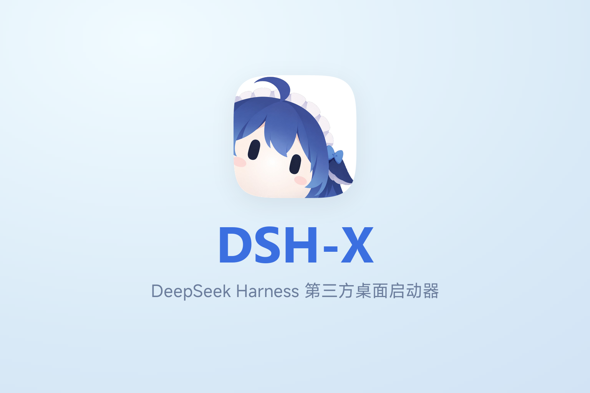

<p align="center">
  
</p>

<p align="center">
  <a href="https://yyh-001.github.io/DSH-X/">主页</a>
  ·
  <a href="https://github.com/yyh-001/DSH-X/releases/latest">下载</a>
  ·
  <a href="https://github.com/yyh-001/DSH-X">Star</a>
  ·
  <a href="README.en.md">English</a>
</p>

<p align="center">
  <a href="https://github.com/yyh-001/DSH-X/releases"></a>
  <a href="https://www.npmjs.com/package/@yyh001/dsh-x"></a>
  
  
</p>

DSH-X 是 DeepSeek Harness 的第三方轻量桌面启动器：启动项与多实例，版本、插件、整合包、MCP 和技能管理。

> [!IMPORTANT]
> **DSH-X 启动的是 DeepSeek Harness 官方原版 Web 页面。**  
> 它只负责版本安装、启动和插件管理，不修改也不重做 DSH 的网页界面。DSH-X 本身是社区开源项目，并非 DeepSeek 官方产品。

## 功能

- **启动项与多实例**：按项选择用户目录、profile、版本和端口；支持并行启动，运行中也可添加启动项。
- **版本管理**：独立管理已安装版本，支持检测新版本、手动安装、卸载和为启动项指定版本。
- **插件与整合包**：按环境安装、开关和更新插件，可配置官方自定义插件市场的默认索引源；整合包社区市场支持瀑布流浏览、搜索和排序，也可导入、导出整合包。
- **MCP 与技能**：配置 MCP 服务器，导入、管理和开关技能。
- **多种打开方式**：DSH-X 内部标签页、系统浏览器标签页、浏览器独立窗口或桌面窗口。
- **外观**：浅色 / 深色主题、透明度、开场与启动项动效，以及独立的背景和大肥鱼开关。
- **更新与恢复**：自更新、故障恢复、可设置保留数量的旧版本清理；启动项当前与上一次使用的版本额外保留。
- **Windows / macOS / Linux**：Windows 安装包、Apple Silicon / Intel 两种 dmg、Linux AppImage（macOS 13 及以上），支持托盘 / 菜单栏常驻和开机自启，自带 npm / pnpm 包装。

交流 / 反馈：**QQ 群 [993579665](https://qm.qq.com/q/7AD2g70HqS)**（[点击加入](https://qm.qq.com/q/7AD2g70HqS)）

## 整合包

整合包把一组插件和配置装进选定的环境（profile）。插件页按环境展示，装过包的环境会标明来源，插件仍可单独开关。使用 [DSH-PackForge](https://github.com/DSH-PackForge/DSH-PackForge) `.dspack` 格式（manifest v5，兼容旧版本）。

- **导入**：社区市场、本地文件、直链或 GitHub `owner/repo`。默认安装到当前选中的环境，确认前可切换目标。
- **安装**：先查看插件和文件变更，再确认安装；覆盖前备份，失败自动回滚。
- **导出**：把当前环境的依赖、补丁层与配置打成 `.dspack`，不含 `node_modules` 与凭据。

仓库中的 [推荐整合包配方](packs/dsh-x-recommended/manifest.json) 包含配置管理、记忆、同步和大肥鱼装饰插件，均从 npm 安装。同步由可选插件 `dsh-x-sync` 提供。运行 `node scripts/make-pack.mjs` 可生成 `.dspack`，再作为本地文件导入。

## 界面预览

**多启动项 · 深色主题**

<p align="center">
  
</p>

<details>
<summary>深色主题：管理界面（展开查看）</summary>

**环境列表**

<p align="center">
  
</p>

**插件管理**

<p align="center">
  
</p>

**整合包市场**

<p align="center">
  
</p>

**常规设置**

<p align="center">
  
</p>

</details>

<details>
<summary>浅色主题：主页与管理界面（展开查看）</summary>

**启动器主页**

<p align="center">
  
</p>

**环境列表**

<p align="center">
  
</p>

**插件管理**

<p align="center">
  
</p>

**整合包市场**

<p align="center">
  
</p>

**常规设置**

<p align="center">
  
</p>

</details>

**多标签页 · 深色主题**

<p align="center">
  
</p>

## 动态壁纸

配套的 Wallpaper Engine 壁纸[《DSH-X · 大肥鱼桌面终端》](https://steamcommunity.com/sharedfiles/filedetails/?id=3814706575)：DSH-X 品牌开场、大肥鱼、本机时间与音乐频谱，按时间自动切换深浅配色。源码在 [`wallpaper/`](wallpaper/)，`node scripts/export-wallpaper.mjs` 导出 Wallpaper Engine 工程。

<p align="center">
  
</p>

## 签名与杀软误报

发布清单的签名用于校验文件完整性，与 Windows 发布者签名不同。目前 `DSH-Setup-<版本>.exe` 和给 0.1.18 旧更新器用的兼容桥 `DSH-Setup.exe` 都尚未做 Authenticode 签名，可能出现 SmartScreen「未知发布者」提示。杀软误报可向[微软](https://www.microsoft.com/en-us/wdsi/filesubmission)或对应杀软厂商提交安装包申诉。

## 使用

Windows：[到发布页下载](https://github.com/yyh-001/DSH-X/releases/latest) `DSH-Setup-<版本>.exe` 安装，从桌面打开 **DSH-X**。

macOS：打开 `DSH-X-<版本>-arm64.dmg`（Apple Silicon）或 `DSH-X-<版本>-x64.dmg`（Intel），把 **DSH-X** 拖进「应用程序」。目前使用临时签名、未做公证，首次打开可能需要在系统安全提示中手动允许；mac 的外壳自更新暂不提供，核心仍走 npm 更新。

Linux：下载 `DSH-X-<版本>-x86_64.AppImage`，`chmod +x` 后直接运行；如果系统没有 FUSE，可用 `./DSH-X-<版本>-x86_64.AppImage --appimage-extract-and-run`。配置在 `~/.config/DSH`，核心缓存在 `~/.cache/dsh-x`。AppImage 的外壳更新走 electron-updater，核心更新走 npm。

在主页添加或编辑启动项，选择环境与版本后启动；编辑启动项时可打开 **版本管理**，手动安装或卸载版本。设置 → 常规 → **打开 dsh 的方式** 可选择 DSH-X 内部标签页、浏览器或独立窗口。内部标签页需要使用安装后的桌面端。

管理页默认端口为 `3780`，被占用时会顺延。手机或其他电脑访问 dsh：设置 → 高级设置 → **Web 绑定**选「局域网」，下次启动生效。

核对下载到的包（可选）：Release 页面每个文件旁边有 sha256，本地对一下即可 —— Windows `certutil -hashfile DSH-Setup-<版本>.exe SHA256`，macOS `shasum -a 256 DSH-X-<版本>-arm64.dmg`，Linux `sha256sum DSH-X-<版本>-x86_64.AppImage`。

## 开发

本机需要 Node.js 22.18+。启动器本身没有第三方依赖：`npm start` 启动管理页，只起服务用 `npm run server`，测试用 `npm test`。外壳是 Electron，`npm run electron` 或打安装包前先 `npm install`。

## 打包

```sh
npm install
npm run dist
```

Windows 产出 `release/eb/DSH-Setup-<版本>.exe`（NSIS）和给 0.1.18 旧更新器用的兼容桥 `release/eb/DSH-Setup.exe`；macOS 产出 `release/eb/DSH-X-<版本>-<arch>.dmg`；Linux 产出 `release/eb/DSH-X-<版本>-x86_64.AppImage`。安装包由 electron-builder 生成，不再需要 Rust / Inno Setup。

发版前检查版本与产物（发布清单与 SBOM 只在本机自查，不上传 Release）：

```sh
node scripts/release-manifest.mjs check-tag v0.1.22
node scripts/release-manifest.mjs verify
```

GitHub Actions 的 `build` 工作流构建 Windows / macOS / Linux 三个平台的安装包，并在 tag 上发布 npm 核心包与 CLI。macOS 目前只出 dmg（临时签名，外壳自更新暂不提供）；Linux 用 AppImage + `latest-linux.yml`。

发布清单的私钥在 `release/release-key.pem`（已被忽略、不进仓库，**务必备份**）。

## 参与

- 开发、提交与发版约定见 [CONTRIBUTING.md](CONTRIBUTING.md)；安全问题见 [SECURITY.md](SECURITY.md)，别开公开 issue。
- 每个版本改了什么，见 [docs/releases](docs/releases)。

## 许可

MIT

