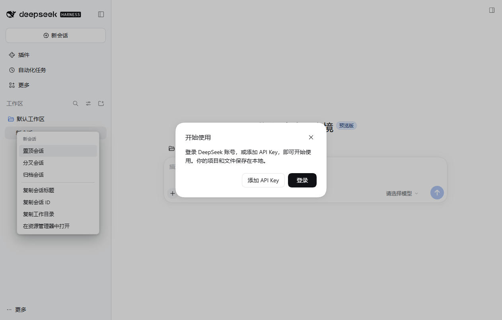

# dsh-x-context-menu

给 [DeepSeek Harness](https://github.com/deepseek-ai/deepseek-harness)（dsh）网页界面加一套**右键菜单**：左侧会话行、工作区行、对话正文里的选中文字、正文里的链接、输入框，各自一套。参考了 [dsh-tauri](https://github.com/dsh-tauri/deepseek-harness-desktop) 的 `dsh-tauri-rightclick`，但重写成纯 dsh 插件 —— **不依赖任何桌面外壳**，浏览器里跑 dsh 也能用。

菜单是自绘的，颜色走 dsh 自己的 `--dsw-alias-*` 设计令牌，跟界面同色；不弹系统原生菜单（原生菜单不跟主题走，Windows 上还会闪一下系统样式）。



## 五个面

| 在哪右键 | 菜单项 |
| --- | --- |
| 会话行 | 重命名… / 置顶（或取消置顶）/ 分叉会话 / 归档会话（已归档的显示取消归档）· 复制会话标题 / 复制会话 ID / 复制工作目录 / 在资源管理器中打开 |
| 工作区行 | 新建会话 · 复制工作区名称 / 复制工作区路径 / 在资源管理器中打开 |
| 正文选中文字 | 复制 |
| 正文里的链接 | 复制链接地址 / 在浏览器中打开（只放行 http/https） |
| 输入框（含对话输入框） | 剪切 / 复制 / 粘贴 / 全选 |

没有可做的面（比如右键空白处）时**不拦默认行为**：菜单根本不出现，页面该怎样还怎样。

## 动作打哪儿走

- **官方服务，不点菜单文字。** 重命名走 `sessions` 控制器的 `rename`；置顶 / 分叉 / 归档 / 新建会话走 `uiWorkspace` 的 `pinSession` / `forkSession` / `archiveSession` / `startSession`。官方改文案、改行内菜单都影响不到这里。
- **系统动作先走外壳，再自己动手。** 在 DSH-X 里优先用外壳借出来的 `dshDesktop`（`reveal` / `open`，由 Electron 主进程执行）；只有外壳不在（浏览器模式、自己起的 dsh）才由本插件 spawn。**顺序不能反**：插件自己 spawn 的 `explorer.exe` 属于后台进程，Windows 的前台锁会让新窗口停在浏览器窗口后面——用户看到的现象是「提示打开了，但什么都没弹」。
- **本机兜底的环回路由**：`POST /api/x-context-menu/reveal` 与 `/open-url`，只认环回来源、只收存在的绝对路径、只放行 http/https，其余一律 400。
- 能力缺席（老核心没有置顶、精简 profile 没有工作区 UI）时，对应菜单项直接不出现，不会点出一个「不可用」。

## 装上

```powershell
dsh plugin --profile web add dsh-x-context-menu
```

装完重启 `dsh web`。插件只在浏览器端注册一个 `shell.overlay` 覆盖层加一个 `contextmenu` 监听，不改官方任何组件。

## 实现要点

- 目标解析靠官方自己打的标记：会话行 `data-row-key="session:<id>"`、工作区行 `data-row-key="workspace:<key>"`，不靠标题文字猜。
- 菜单挂在 `shell.overlay` 插槽里（和官方行菜单同一层），没有单独的 React root；定位按光标坐标，贴边时自动翻到另一侧。
- 键盘：↑/↓ 移动、Enter 执行、Esc 关闭；点到菜单外面、滚轮/触摸滚动、窗口失焦都会关。**不跟 `scroll` 事件**：dsh 的标题跑马灯、聊天流式输出、列表补位都会触发 scroll，跟着关会变成「鼠标一动菜单就没了」。
- 重命名不用 `window.prompt`（Electron 里不弹），是本插件自己的小弹窗。

## 开发

```powershell
node --test            # 主机侧纯函数 + 客户端包的契约断言
```

主机侧没有构建步骤：`lib/index.js` 是 ESM，`lib/client.js` 是 `window.__ModuleLoader__` 工厂产物，和 `dsh-x-memory` / `dsh-x-sync` 同一套形态。

## 已知边界

- **空白会话不给重命名**：官方界面里 `blank` 会话的行标题固定显示「新会话」（`displayTitle` 直接返回占位文案），改了标题也看不出来，所以这类行的菜单里干脆没有这一项；发过消息的会话正常显示。已归档的行把「归档会话」换成「取消归档」。
- `sessions.manager.rename` / `uiWorkspace.workspaces` 都是运行时字段（不是 dsh 对外承诺的公开接口）。dsh 换版本后如果这两个取不到，重命名会退回 `sessions.binding(id).session.rename`，再取不到就只报错不崩。
- 输入框的粘贴读的是系统剪贴板（`navigator.clipboard.readText`），浏览器不给权限时提示「剪贴板不可用」，不会静默失败。

## 许可

MIT。
